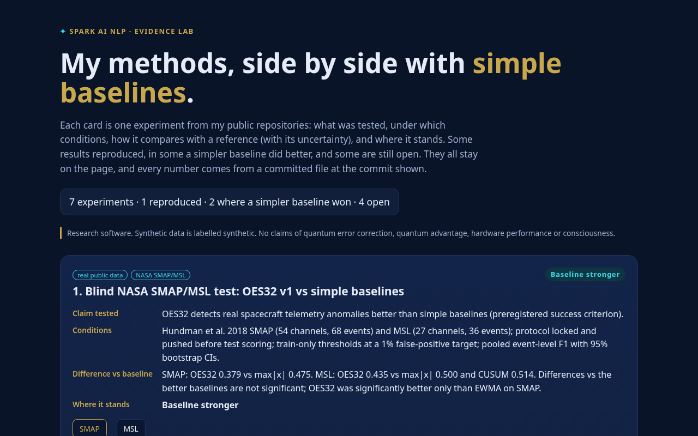

# Spark Evidence Lab

**My methods, side by side with simple baselines, including where the baseline wins.** Live: **https://sparkainlp-x.github.io/spark-evidence-lab/**

[](https://github.com/sparkainlp-x/spark-evidence-lab/actions/workflows/ci.yml)
[](https://github.com/sparkainlp-x/spark-evidence-lab/actions/workflows/pages.yml)
[](LICENSE)
[](https://doi.org/10.5281/zenodo.23403169)



Each card is one experiment from my public repositories. It shows the **claim tested**, the **conditions**, the **difference against a baseline with its uncertainty**, a **status** (Reproduced / Baseline stronger / Open question / Exploratory), a short *What I learned* line, links to the code at an exact commit, the DOI where one exists, the next step, and the commands to rerun it from a clean checkout. Every number is copied from a committed file in the source repository; nothing is estimated here.

| # | Experiment | Source (commit) | Verdict |
|---|---|---|---|
| 1 | Blind NASA SMAP/MSL test, OES32 v1 vs baselines | [oes-resilience `e3e03d5`](https://github.com/sparkainlp-x/oes-resilience/blob/e3e03d5cc6b54e9d9818fd83d7a1e041f6800224/reports/smap_msl_results/smap_msl_summary.csv) | Baseline stronger |
| 2 | OES-32-v2 locked re-attempt | [oes-resilience `79edb72`](https://github.com/sparkainlp-x/oes-resilience/blob/79edb72c861fa487ec63e14f9d10d0a55525d513/oes32-v2/reports/OES32_V2_REPORT.md) | Baseline stronger |
| 3 | qbench transpiler comparison (simulator only) | [oes-resilience PR #5 `0e11656`](https://github.com/sparkainlp-x/oes-resilience/blob/0e1165610e2ddb6445fec507b95d8b7a7f8b2979/examples/qbench_sample/qbench_report.md) | Open question |
| 4 | OES-32 residual JS port + live replay | [oes32-residual `136f258`](https://github.com/sparkainlp-x/oes32-residual/blob/136f2584c8e81d31edbe418652eed1616cd498cd/residual_definition.md) | Reproduced |
| 5 | OES-512 synthetic 512-channel stream | [oes512-telemetry-engine `95d99a1`](https://github.com/sparkainlp-x/oes512-telemetry-engine/blob/95d99a16c61ef700a58f668e35e61ad051e4d8cc/main.py) | Exploratory |
| 6 | Digital to Wave Part II THz validity check | [digital-to-wave-2-thz-validity `c8721fa`](https://github.com/sparkainlp-x/digital-to-wave-2-thz-validity/blob/c8721fa8974d92db66f696e6006460b84e0f70c2/README.md) | Open question |
| 7 | Surface-code memory toy (Stim + PyMatching) | [qec-scaling-bench `0125bdb`](https://github.com/sparkainlp-x/qec-scaling-bench/blob/0125bdb475cbbc7886f075ef2dd8055d97d5f7ad/results/scaling_sweep_seed_1823.json) | Open question |

## Scope

Research software. The live replays (cards 4 and 5) run in your browser on **synthetic** data. Card 3 is simulator-only, card 7 is a classical toy simulation, card 6 is synthetic. Nothing here claims quantum error correction, a threshold, quantum advantage, hardware performance or consciousness.

## Run locally

```bash
git clone https://github.com/sparkainlp-x/spark-evidence-lab && cd spark-evidence-lab
npm test                      # JS residual port vs Python contract vectors (bit-exact)
python3 -m http.server -d site 8000   # open http://localhost:8000
```

No dependencies, no build step, no backend, no tracking. The page works offline once loaded.

**Contract vectors.** `tests/vectors.json` is generated by `tools/gen_vectors.py` from the Python reference in [oes32-residual](https://github.com/sparkainlp-x/oes32-residual) at the commit recorded in the file. CI regenerates it from that commit, diffs it, then runs the node tests, the build and a link check of every commit, file and DOI the site cites.

## About

Jean-François Brisson, Fredericton, New Brunswick, Canada · [ORCID 0009-0000-9778-5374](https://orcid.org/0009-0000-9778-5374) · [Spark AI NLP](https://sparkainlpx.xyz). Built with Grok Bot.

## License

AGPL-3.0-only ([LICENSE](LICENSE)); commercial licensing in [COMMERCIAL-LICENSE.md](COMMERCIAL-LICENSE.md). Cite with [CITATION.cff](CITATION.cff). Archived on Zenodo: concept DOI [10.5281/zenodo.23403169](https://doi.org/10.5281/zenodo.23403169) (all versions). Version DOI for v0.1.0: [10.5281/zenodo.23403170](https://doi.org/10.5281/zenodo.23403170).
